# Bom dia, boa tarde, boa noite. Eu sou o Leonardo Moraes! Seja bem-vindo(a) ao meu perfil. 🖖

Sou um estudante de Ciência da Computação apaixonado por tecnologia e por resolver problemas.

💡 Atualmente focado em evoluir minhas habilidades e construir projetos desafiadores.

---

## 👨‍💻 Sobre Mim

- 🎓 Cursando **Ciência da Computação**.
- 💼 Atualmente trabalhando como **Analista em Telecomunicações** na área de **VoIP**.
- 🌱 Explorando áreas como **análise de dados**, **desenvolvimento front e back-end** e **Segurança Cibernética**.
- 🤖 Estudando **Inteligência Artificial** e usando o **Claude** e o **Claude Code** no dia a dia para programar, como no [Pet de Desktop](https://github.com/LeoMagaMoraes/clawd-desktop-pet), um mascote que reage ao Claude Code.
- 🚀 Buscando oportunidades para aplicar meu conhecimento e aprender com novos desafios.

---

## 🛠️ Tecnologias e Ferramentas

Aqui estão algumas das tecnologias com as quais tenho trabalhado:

  

### 🤖 Inteligência Artificial

Estudando IA e usando assistentes de IA para programar:

  
  

---

## 🚀 Projetos em Destaque

- 🔴 **[Pokédex Web](https://github.com/LeoMagaMoraes/PokedexWeb)** ([acesse online](https://leomagamoraes.github.io/PokedexWeb/)): Pokédex interativa em HTML, CSS e JavaScript puro, consumindo a PokeAPI. Tem os 1025 Pokémons com busca, filtros, favoritos, comparação, montagem de times e simulador de batalha.
- 🦀 **[Pet de Desktop](https://github.com/LeoMagaMoraes/clawd-desktop-pet)**: mascote de desktop estilo tamagotchi em Python, que reage ao Claude Code e muda conforme o clima.

---

## 📊 Minhas Estatísticas no GitHub

  
  

---

## 📫 Entre em Contato

Sinta-se à vontade para se conectar comigo!

 
  
  

---

  
<b>🌎 English Version</b>

  
   

  # Hello there! I'm Leonardo Moraes! Welcome to my profile. 🖖
  
  I am a Computer Science student passionate about technology and problem-solving.
  
  💡 Currently focused on evolving my skills and building challenging projects.
  
  ---
  
  ## 👨‍💻 About Me
  
  - 🎓 Studying **Computer Science**.
  - 💼 Currently working as a **Telecommunications Analyst** in the **VoIP** field.
  - 🌱 Exploring areas like **data analysis**, **front-end and back-end development**, and **Cybersecurity**.
  - 🤖 Studying **Artificial Intelligence** and using **Claude** and **Claude Code** every day to write code, as in [Desktop Pet](https://github.com/LeoMagaMoraes/clawd-desktop-pet), a mascot that reacts to Claude Code.
  - 🚀 Looking for opportunities to apply my knowledge and learn from new challenges.
  
  ---
  
  ## 🛠️ Tech Stack & Tools
  
  Here are some of the technologies I've been working with:
  
  

    
  

  ### 🤖 Artificial Intelligence

  Studying AI and using AI assistants to write code:

  

    
    
  

  
  ---
  
  ## 🚀 Featured Projects

  - 🔴 **[Pokédex Web](https://github.com/LeoMagaMoraes/PokedexWeb)** ([try it online](https://leomagamoraes.github.io/PokedexWeb/)): interactive Pokédex in plain HTML, CSS, and JavaScript, powered by the PokeAPI. All 1025 Pokémon with search, filters, favorites, comparison, team building, and a battle simulator.
  - 🦀 **[Desktop Pet](https://github.com/LeoMagaMoraes/clawd-desktop-pet)**: tamagotchi-style desktop pet in Python that reacts to Claude Code and changes with the weather.

  ---

  ## 📊 My GitHub Stats
  
  

    
    
  

  
  ---
  
  ## 📫 Get in Touch
  
  Feel free to connect with me!
  
  
 
    
    
  

